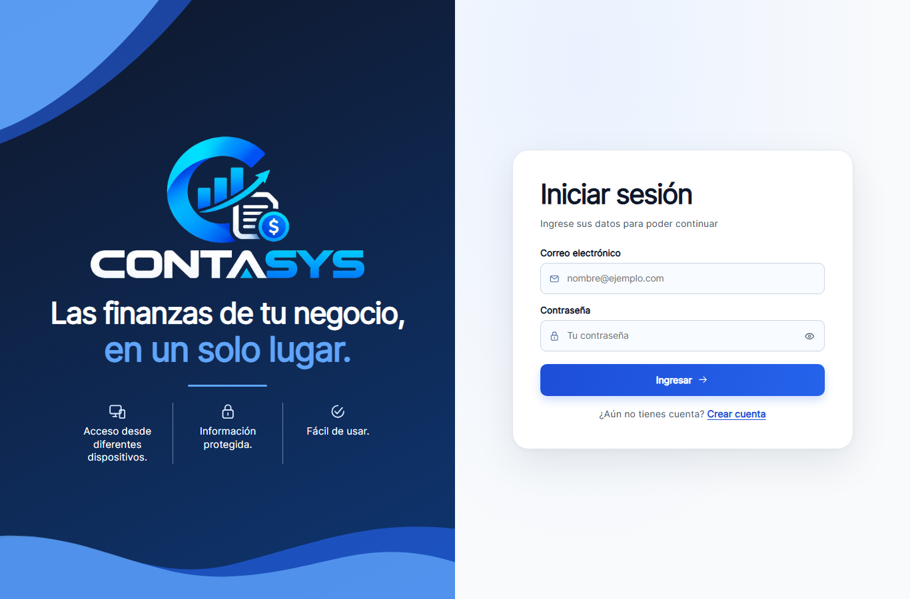

# CONTASYS

<picture>
  <source media="(prefers-color-scheme: dark)" srcset="css/marca/contasys.png">
  
</picture>

CONTASYS es un sistema de gestión contable y financiera para pequeños negocios. Permite controlar movimientos, presupuestos y facturación interna, consultar reportes y compartir acceso con un contador autorizado.

Su objetivo es ayudar a emprendedores y microempresas a registrar sus operaciones y consultar su situación financiera por periodo.

Consulta las novedades y limitaciones de [CONTASYS v1.1.0](CHANGELOG.md).

## Funcionalidades

- **Emprendedor.** Dashboard, ingresos, egresos, presupuestos, facturas internas, reportes, análisis financiero, suscripción y control del acceso delegado.
- **Contador.** Clientes vinculados y consulta financiera según el permiso concedido. La consulta de facturas depende de una autorización separada y revocable.
- **Administrador.** Gestión del estado y rol de usuarios, de categorías financieras y de métodos de pago.
- **Servicios comunes.** Registro, inicio y cierre de sesión, Mi cuenta, notificaciones y Chat. Los planes Free y Premium conservan sus restricciones. El cobro simulado se limita a los entornos habilitados para pruebas.

## Planes Free y Premium

- **Free.** Incluye el registro y la consulta de movimientos. Permite hasta tres presupuestos activos vigentes.
- **Premium.** Quita ese límite, añade alertas preventivas de presupuesto y habilita las exportaciones de reportes en PDF y Excel.

## Arquitectura y tecnologías

El frontend utiliza HTML, CSS y JavaScript. Consume una API REST en Node.js y Express. MySQL almacena usuarios, sesiones, movimientos, facturas y demás datos. La API valida el rol, el estado de la sesión y los permisos delegados. Chart.js, jsPDF y SheetJS se sirven desde [vendor](vendor/README.md).

## Instalación

1. Instala Node.js 22 y MySQL. Ejecuta `npm ci` en la raíz del proyecto y en `backend/`.
2. Copia `backend/.env.example` a `backend/.env` y configura tu conexión y el secreto de sesión. Conserva el archivo fuera de Git.
3. Instala el esquema y las migraciones según la [guía del backend](backend/README.md). Para actualizar una instalación existente, consulta la [guía de respaldo y actualización](evidencias/fase7/INSTALACION_RESPALDO.md).
4. Ejecuta `npm.cmd --prefix backend start` desde la raíz. Comprueba la respuesta de `/api/salud`.
5. Sirve la raíz del proyecto por HTTP, por ejemplo con Live Server en el puerto 5500, y abre `index.html`. Sirve también `css/`, `js/` y `vendor/`. Para otro origen, configura la URL de la API y CORS según la guía del backend.

Los [datos de demostración](database/pruebas/DATOS_DEMO.sql) son opcionales y están destinados a esquemas de prueba independientes. Los resultados históricos están en el [informe de fase 7](evidencias/fase7/INFORME.md), su [revisión de seguridad](evidencias/fase7/SEGURIDAD.md) y las [mediciones de fase 6](evidencias/rendimiento-fase6/RESULTADOS.md).

## Capturas

Las pantallas se capturaron en Chromium sin ingresar datos de usuario.




## Limitaciones actuales

La facturación es interna o demostrativa. Los pagos de suscripción se simulan en los entornos habilitados para pruebas. La edición de perfil y contraseña desde Mi cuenta, la búsqueda y paginación de usuarios y la edición de catálogos siguen pendientes.

## Validación académica de CONTASYS v1.1.0

Las verificaciones de la versión candidata se ejecutaron con datos ficticios en MySQL aislado.

### Cómo repetir las pruebas

Usa la carpeta raíz de CONTASYS, Node.js, Chrome y MySQL. Configura las variables de conexión `DB_HOST`, `DB_PORT`, `DB_USER` y `DB_PASSWORD` en la terminal para apuntar a una instancia MySQL aislada. Las pruebas crean esquemas con nombres aleatorios. Confirman el esquema activo antes de cargar el SQL y comprueban también el esquema de la conexión que usa la API de prueba. Los datos de cada prueba son ficticios.

```powershell
$env:CONTASYS_PRUEBA_MYSQL = '1'
$env:CONTASYS_NAVEGADOR = 'C:/Program Files/Google/Chrome/Application/chrome.exe'
npm.cmd --prefix backend test -- --test-concurrency=1
npm.cmd run test:e2e
npm.cmd audit
npm.cmd --prefix backend audit
```

Cypress levanta la API real en un puerto local temporal, utiliza una cuenta SQL restringida al esquema de prueba y la bloquea al terminar. El comando imprime la ruta local de sus artefactos. En la instalación donde se realizó la revisión, la evidencia adicional se conserva en `evidencias/validacion-v1.1.0/`. Los informes técnicos históricos y sus ejemplos ficticios están en `evidencias/fase7/` y `evidencias/rendimiento-fase6/`.

### Verificación del 25 de noviembre de 2026

- Backend, MySQL y Chromium aprobaron 21 de 21 pruebas.
- Cypress aprobó 10 de 10 casos al repetir la suite. En la primera corrida aprobó 9 de 10 porque el archivo Excel apareció después de agotarse la espera de la prueba. El archivo de esa corrida también se verificó independientemente y contenía las 124 filas esperadas.
- Las auditorías npm de la raíz y del backend reportaron cero vulnerabilidades en los manifiestos examinados.
- Con 10.000 registros ficticios por listado, las medianas paginadas fueron 25,48 ms en Ingresos y 20,40 ms en Egresos, con tres consultas SQL por respuesta. MySQL recorrió en orden inverso los índices de fecha y leyó 60 movimientos para obtener las 51 filas que usa el paginador. El cálculo de los totales globales se ejecutó por separado.
- Reportes y MySQL coincidieron en $52.602,66 COP para cada tipo de movimiento confirmado. La línea base sin paginación de este mismo ensayo tardó 139,24 ms en Ingresos y 102,90 ms en Egresos. El cambio de paginación impide atribuir toda la diferencia al índice.

### Resultados de la validación previa

- **Backend, MySQL y Chromium:** 21 pruebas aprobadas durante la validación. El plazo global de la suite MySQL se amplió para dar margen a sus migraciones y diez casos secuenciales. Se conservó la comprobación del tiempo de espera del pool.
- **Cypress con la API real:** 10 de 10 casos aprobados durante la validación. La prueba responsive abre el menú en celular y consulta en Reportes el periodo de los movimientos ficticios. La prueba de emisión espera las respuestas HTTP de creación y recarga del historial antes de comprobar el contenido y el PDF.
- **Correcciones recientes:** Chromium con la API real verificó eliminación de movimientos permitidos, protección del ingreso asociado a un pago, edición y emisión de borrador, descarga PDF, solicitudes y revocación, separación de permisos delegados, contraste del botón Aceptar, confirmación roja al desactivar y revocación de la sesión. Se comprobó en Mi cuenta la ausencia de los textos retirados.
- **Responsive y marca:** 15 páginas en cinco resoluciones y dos alturas útiles adicionales. Las 105 vistas con API simulada cargaron el favicon oficial y no registraron desbordamiento horizontal de la página ni errores JavaScript. Inicio de sesión y Error de acceso ajustaron su altura al navegador. El botón de Error de acceso recibió foco visible con Tab y volvió al inicio con Enter. En Chat se comprobó que el compositor permanece visible tras abrir una conversación en escritorio con 640 px de altura útil. Se generaron capturas de la marca en las interfaces y en PDF con datos ficticios.
- **Seguridad:** cero vulnerabilidades reportadas por `npm audit` en raíz y backend. Las tres bibliotecas de navegador en `vendor/` quedan fuera de esos manifiestos y sus huellas SHA-256 coincidieron con el inventario registrado. La regresión cubrió sesiones, revocación, roles, accesos delegados, privacidad de notificaciones y restricciones de planes.

### Exactitud financiera y rendimiento

El comparador de rendimiento genera conjuntos ficticios de 100, 1.000 y 10.000 registros por listado y compara las respuestas antes y después del índice de rendimiento. Para cada periodo suma en MySQL únicamente los movimientos confirmados del titular y contrasta los importes exactos con Reportes. En los tres volúmenes coincidieron los ingresos y egresos por separado. Los importes fueron 521,73 COP, 5.258,22 COP y 52.602,66 COP por cada tipo de movimiento. Las demás cifras financieras comparadas se mantuvieron iguales entre las dos ejecuciones.

La medición de API registra la mediana de siete solicitudes tras un calentamiento, en loopback y con 10.000 registros ficticios por listado. Las fases 6 y 7 son referencias históricas. En los ensayos lentos MySQL ordenó 8.571 filas en Ingresos para devolver 51. En dos repeticiones con el mismo conjunto nuevo, el motor usó un recorrido inverso por el índice de fecha en ambos listados y leyó 60 filas para obtener 51. La API usa la fila adicional para saber si hay una página siguiente y envía 50. El código del controlador, el SQL y los índices son idénticos a v1.0.0. La diferencia observada en esos ensayos proviene del plan de MySQL. La información histórica disponible permite identificar el plan lento y su trabajo adicional, aunque carece de una captura de las estadísticas internas con las que el optimizador lo eligió.

| API con 10.000 registros | Fase 6, ms | Fase 7, ms | Ensayos lentos v1.1.0, ms | Dos repeticiones finales, ms |
| --- | ---: | ---: | ---: | ---: |
| Ingresos | 11,48 | 11,38 | 142,43–172,01 | 11,01 y 16,41 |
| Egresos | 10,03 | 12,32 | 132,13–143,77 | 11,37 y 13,34 |

Los listados conservaron tres consultas SQL por petición en la medición de API, el cursor por fecha e identificador, los filtros y los totales verificables. La carga de categorías y métodos de pago comienza en paralelo en el navegador. El menú compartido ofrece WebP sin pérdida con respaldo PNG. Ambas variantes WebP tienen las mismas dimensiones y píxeles RGBA que los PNG de origen.

El plan lento inició por los catálogos: estimó una fila para su combinación y procesó 42. Después buscó movimientos por usuario y categoría para cada combinación, comprobó el método de pago y ordenó los resultados. El plan rápido inicia por los movimientos ordenados. Recorre el índice de fecha y busca cada categoría y método por su clave primaria hasta completar la página. Esa diferencia explica el salto de latencia sin cambiar el tamaño de la página ni la lógica financiera.

En una comparación separada de Chrome 159 a 1366 × 768, ambas versiones recibieron la misma respuesta simulada y renderizaron dos páginas de 50 movimientos. Cada navegación y su paginación hicieron seis solicitudes a la API, incluidas dos del listado. Las primeras mediciones tomaron entre 22 y 29 ms de la respuesta al pintado de la primera tabla. En la segunda página, la última ronda midió de 21 a 22 ms en v1.0.0 y de 28 a 38 ms en v1.1.0. La última ronda también registró mayor latencia de la respuesta simulada y mayor variación de tiempos de carga. Las mediciones de memoria JavaScript son instantáneas de una sesión de navegador reutilizada y no miden el consumo total.

Con la caché deshabilitada, los recursos del frontend de los listados pasaron de 356.307 bytes en la medición inicial de v1.1.0 a 249.194 bytes después de la optimización, aproximadamente un 30 % menos. La referencia v1.0.0 usa 36.274 bytes y tenía una presentación más ligera. El costo adicional de la primera carga permanece documentado.

Se registraron además 16 cargas en Chrome 159 a 1366 × 768 con API simulada local y gráficas con datos ficticios. Tras la primera visita de cada página, la mediana del evento `load` fue 85,1 ms en Inicio de sesión, 79,7 ms en Dashboard, 313,7 ms en Reportes y 98,4 ms en Análisis. La evidencia registra también recursos, solicitudes de API y memoria JavaScript observada en la misma sesión. El evento `load` mide la carga del documento y sus recursos, mientras que el ensayo espera aparte a que Chart.js haya creado las gráficas. Los recursos en caché y la reutilización del navegador limitan la comparación de transferencia y memoria. Las fases anteriores no aportan una referencia equivalente de navegador.
